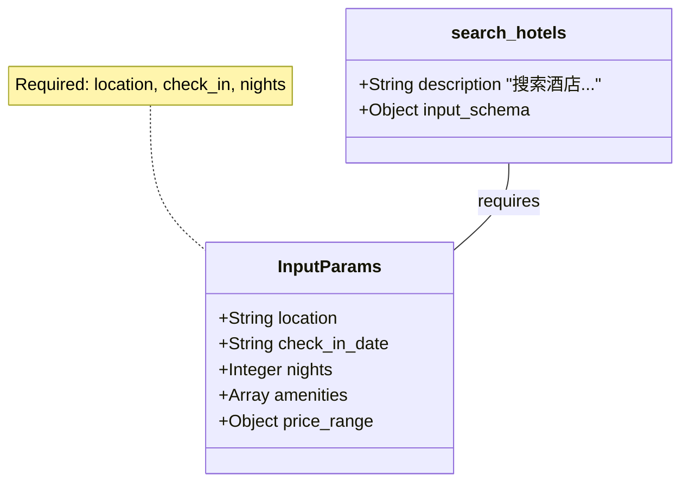

## 3.2 定义工具 Schema

### 3.2.1 什么是工具 Schema？

与 Claude 进行工具集成时，开发者提供的是一份 **Schema**（结构定义），而不是代码函数本身。Schema 相当于一份“说明书”，告诉 Claude 工具的名称、用途，以及调用时参数应遵循的格式。

Claude 工具定义使用 **JSON Schema** 风格的结构来描述参数，但生产系统应按 Anthropic Structured Outputs / Strict Tool Use 文档核验当前支持的子集、复杂度限制和无效输出处理路径。Schema 是强约束手段，但并不保证“任意 JSON Schema 都完整执行”。

### 3.2.2 工具定义的三大支柱

标准的工具定义（Tool Definition）由名称、描述和参数结构三个核心字段构成，每个字段都直接影响模型的判断准确性和 Token 消耗。

#### Name：名称

工具的唯一标识符。
*   **格式限制**：必须匹配正则 `^[a-zA-Z0-9_-]{1,128}$`。通常推荐使用 `snake_case`（蛇形命名法），如 `get_stock_price`。
*   **最佳实践**：名称本身应具有语义，因为 Claude 会参考工具名称。例如 `search_database` 比 `tool_a` 更能引导模型正确使用。

#### Description：描述

这是工具定义中最重要的部分，`description` 的作用常被低估：这里的文本会作为系统提示词 (System Prompt) 的一部分输入给模型。

**编写高质量描述的技巧**：
*   **明确“何时”使用**：不要只写“获取天气”，而要写“当用户询问实时天气情况或气温时，使用此工具”。
*   **提供相关上下文**：如果工具返回的数据有特定格式（如 CSV 或 JSON），可以在描述中提及，以便 Claude 做好解析准备。
*   **示例增强**（Few-shot）：对于复杂工具，可以在描述中简要包含一个参数示例。

#### Input Schema：参数结构

定义工具接受的参数格式，是一个标准的 JSON Schema 对象。
*   **`type`**: 通常为 `object`。
*   **`properties`**: 定义各个参数字段。
*   **`required`**: 一个数组，列出必须提供的字段名。Claude 会尽量确保生成的 JSON 包含这些字段。

### 3.2.3 完整示例解析

下面是一个用于“查询酒店”的工具定义，包含多种参数类型。

```json
{
  "name": "search_hotels",
  "description": "根据目的地、日期和价格范围搜索酒店。当用户计划旅行或寻找住宿时使用。",
  "input_schema": {
    "type": "object",
    "properties": {
      "location": {
        "type": "string",
        "description": "目的地城市或地标，如 'Paris' 或 'Eiffel Tower'"
      },
      "check_in_date": {
        "type": "string",
        "format": "date",
        "description": "入住日期，格式 YYYY-MM-DD"
      },
      "nights": {
        "type": "integer",
        "minimum": 1,
        "maximum": 30,
        "description": "入住晚数"
      },
      "amenities": {
        "type": "array",
        "items": {
          "type": "string",
          "enum": ["wifi", "pool", "gym", "breakfast"]
        },
        "description": "所需的设施列表"
      },
      "price_range": {
        "type": "object",
        "properties": {
          "min": {"type": "number"},
          "max": {"type": "number"}
        },
        "description": "价格区间（每晚）"
      }
    },
    "required": ["location", "check_in_date", "nights"]
  }
}
```

#### 结构可视化

把上述 Schema 画成类图，可以看出 Claude 如何理解这个工具。



**图 3-1：工具定义类图**
该类图展示了 `search_hotels` 工具的数据结构。Claude 将其视为一个主对象（Function），它依赖一个参数对象（InputParams），`InputParams` 包含所有必要的字段及其类型约束。设计复杂参数时，这种图示有助于保持逻辑清晰。

### 3.2.4 高级参数技巧

要让 Claude 稳定工作，应通过 Schema **限制生成空间**。

#### 枚举：约束取值，减少幻觉

如果一个字段只有固定的几个有效值（如状态、类型、模式），**务必使用 `enum`**。
*   **Bad**: `"type": "string", "description": "排序方式"`（模型可能生成 'desc', 'descending', 'down' 等）
*   **Good**: `"type": "string", "enum": ["asc", "desc"]`

#### 验证信息：Format 与 Descriptions

JSON Schema 支持 `format: email` 或 `pattern`（正则），但 LLM 并不总是严格遵循这些隐式约束。
**建议**：将格式要求显式写在 `description` 中。
*   `"description": "用户邮箱，必须是有效的 email 格式"`
*   `"description": "日期，严格遵循 YYYY-MM-DD 格式"`

### 3.2.5 开发实战：使用 Pydantic 生成 Schema

在 Python 开发中，手写冗长的 JSON 容易出错。推荐用 `Pydantic` 库定义数据模型并自动生成 Schema。

```python
from pydantic import BaseModel, Field
from typing import List, Optional

class HotelSearch(BaseModel):
    location: str = Field(..., description="目的地城市")
    nights: int = Field(1, ge=1, le=30, description="入住晚数")
    amenities: List[str] = Field(default_factory=list, description="设施列表")

#自动生成 Claude 兼容的 Schema
schema = HotelSearch.model_json_schema()

# 注意：生成的 schema 可能包含 'title' 等额外字段，Claude API 通常会忽略，但最好清理一下。
```

### 3.2.6 实战洞察：工具结构化频谱

工具设计需要在“结构化”与“灵活性”之间取得平衡。Claude Code 团队在实践中总结出一个概念：**工具结构化频谱**。

*   **无结构（过于松散）**：让模型自由输出 Markdown 或自然语言，灵活但难以程序化解析，输出格式不稳定。
*   **甜蜜点（恰到好处）**：设计专用工具，结构化输出参数，模型既能正确调用，程序也能可靠解析。
*   **过度刚性（过于死板）**：在不相关的工具中硬塞额外参数，虽然结构化了，但混淆了模型的语义理解。

Claude Code 团队设计“引导用户澄清”功能时经历了三次迭代，分别对应频谱上的不同位置：

#### 尝试一：扩展现有工具参数（过度刚性）

团队最初在用于生成计划的 `ExitPlanTool` 中新增了一个 `questions` 参数，想让模型在输出计划的同时提出澄清问题。结果**失败**：模型在“给出计划”和“提问”两个矛盾状态之间摇摆，输出质量严重下降。

**教训**：不要让一个工具承担两种语义冲突的职责。

#### 尝试二：自定义输出格式（无结构）

团队转而用提示词指示模型以特定的 Markdown 格式输出问题。结果**不稳定**：模型经常在问题后面追加多余文本，或者忽略格式要求，导致程序解析困难。

**教训**：纯文本格式缺乏强制约束力，模型的遵从率不可靠。

#### 尝试三：专用工具（甜蜜点）

最终，团队设计了一个独立的 `AskUserQuestion` 工具，模型可以在任何时候调用它来向用户提问。工具的 Schema 包含结构化的问题文本和可选的选项列表。结果**成功**：模型能准确调用，输出结构化且一致，程序端可以直接渲染为交互式 UI 组件。

**核心原则**：

*   **一个工具只做一件事**。与其往现有工具里塞参数，不如新建一个语义清晰的专用工具。
*   **独立工具优于参数扩展**。模型对“调用哪个工具”的判断，往往比“在一个工具里填哪些可选参数”更准确。

### 3.2.7 常见陷阱与调试

定义工具时的常见错误如下：

1.  **参数过多且非必填**：一个工具包含 20 个参数且大部分是可选时，Claude 往往难以判断该填哪些。**策略**：拆分为多个专注的小工具，或者将可选参数合并为一个 `options` 对象。
2.  **类型单一**：不要把所有字段都定义为 `string`。需要数字就用 `integer` 或 `number`，需要布尔开关就用 `boolean`，以减少后续代码转换的工作量。
3.  **忽略错误处理**：即使定义了 Schema，未启用 strict 模式时 Claude 仍有极小概率生成不符合 Schema 的 JSON（当前模型在这方面已很可靠，且可用 `strict: true` 从 API 层面保证参数严格符合 Schema，见 3.7 节）。代码必须具备 `try-catch` 机制，在 JSON 解析失败时给 Claude 返回明确的错误信息（Tool Result），让它可以纠正并重试。

### 3.2.8 面向 Agent 的工具设计原则

讨论 Token 成本之前，需要先明确：**为 Agent 设计工具的原则，与为传统软件设计 API 完全不同**。

**工具是人与非人之间的契约**

传统 API 面向程序员设计，开发者会仔细阅读文档、理解边界情况，并据此编写代码。

Agent（LLM）面对大量工具时的能力与限制则不同：它的上下文有限，过多工具会导致混淆；它不具备逻辑编程的严格性，会依据模糊的启发式做决策；它的决策基于概率，而非确定性规则。

**三个工具设计原则**

1. **优先完整性而非最小化**

许多开发者认为工具应该像 REST API 一样最小化，但对 Agent 来说，**一个工具应完成一个完整的业务流程**，而非暴露各个原始操作。

示例对比：
- ❌ **过度细粒度（不适合 Agent）**：
  - `list_users()`
  - `list_events()`
  - `create_event()`

- ✅ **适合 Agent 的完整工具**：
  - `schedule_event(user_name, description, availability)`：内部找到用户、检查可用性、创建事件，一次完成

2. **让工具处理“多步”任务**

Agent 调用工具时，工具可以（也应该）在内部执行多个步骤。这样既减少 Agent 的工具调用次数、降低 Token 消耗，也减轻 Agent 的认知负担：它不需要记住前一个调用的结果再传入下一个调用。

示例：
- 不要让 Agent 先调用 `search_logs(id)`，再调用 `analyze_logs(log_data)`
- 而是让 Agent 调用一次 `investigate_customer_issue(customer_id)`，工具内部处理搜索和分析

3. **工具应该是“人类做什么，工具就做什么”**

设计工具时可以先问：**人类专家接到同样的要求会怎么做？** 然后让工具镜像这个工作流。

例如：
- 人类处理“客户取消请求”时：会找到用户、查看订购历史、发送保留优惠
- 所以工具也应该叫 `handle_cancellation_request(customer_id)` 而非 `cancel_subscription()` + `send_offer()` 两个分开的工具

**根据任务特征选择工具还是参数**

新增功能时，应添加新工具还是添加参数，可参考下表：

| 情景 | 选择 | 原因 |
|------|------|------|
| 两个操作代表完全不同的意图 | 新工具 | Agent 在“调用哪个工具”上的准确度高于“填哪个参数” |
| 一个参数会使工具的名义目标模糊 | 新工具 | 语义清晰的工具名比复杂的参数组合更能引导 Agent |
| 两个操作很少一起使用 | 新工具 | 减少不必要的参数加载到上下文 |
| 两个操作是同一任务的前后步骤 | 同一工具的多个参数 | 合并能减少 Agent 的协调开销 |

---

*融入自 Anthropic 的《Writing effective tools for agents — with agents》中关于工具设计哲学的最佳实践*

### 3.2.9 Token 消耗警示

**整个 Schema 定义都会计入 Input Tokens**。
定义 50 个工具、每个都有详细描述和复杂参数时，可能消耗数千 Token，既增加成本，也可能挤占模型对用户问题的注意力（Attention）。

*   **动态工具加载**：如果在某些对话分支中只需要特定工具，可以动态修改 API 请求中的 `tools` 列表，只发送当下相关的工具。

---

下一节讨论 Claude 调用工具后如何处理返回的结果。

➡️ [处理工具调用结果](3.3_results.md)

---

> **🔥 踩坑实录**
>
> 团队在定义自定义工具时，参数类型中使用了 `"type": "integer"` 而非 `"type": "number"`。在某些场景下，Claude 的数值推理会生成浮点数（比如计算平均值），这些值会被 JSON Schema 校验拒绝。表面现象是“工具调用随机失败”，很难定位，根本原因是参数类型约束过严。改为 `"type": "number"` 后问题消失。教训是分清 `integer` 和 `number`：整数更严格，浮点数更宽容；业务允许时优先选择 `number`。
