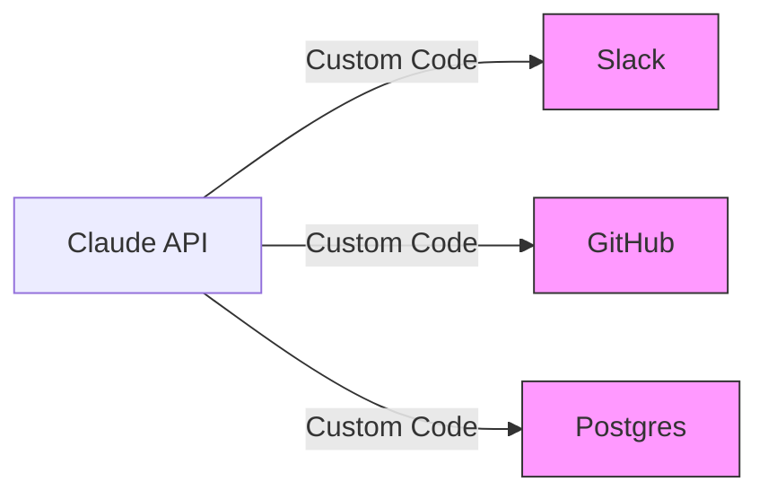
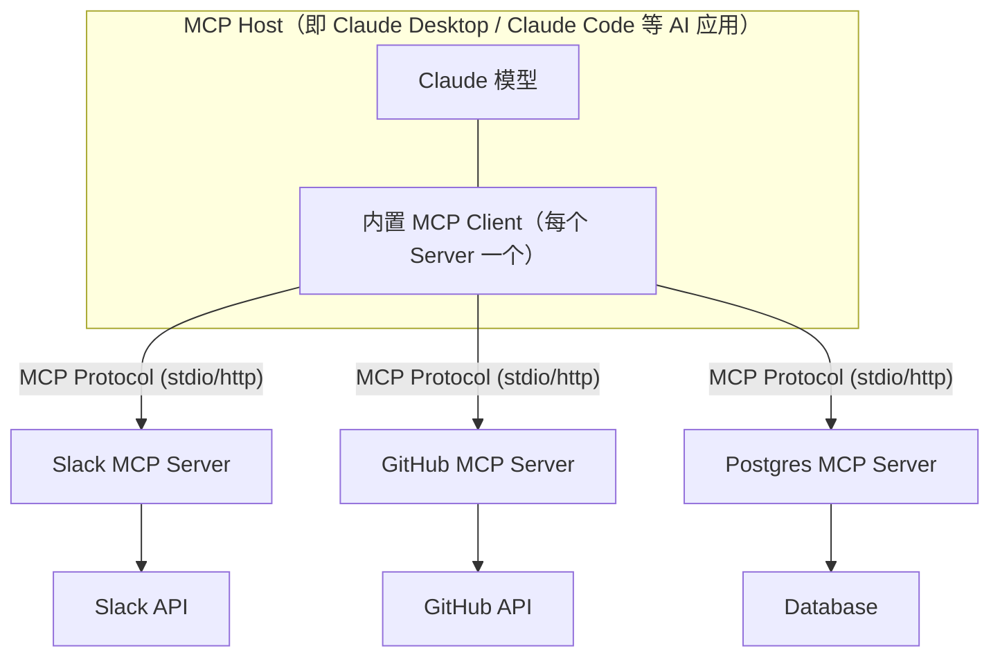

## 4.1 MCP 是什么：AI 世界的 USB-C

2024 年之前，要让 Claude 读取电脑上的文件或查询公司的数据库，需要编写大量“胶水代码”，就像在不同品牌的手机充电器之间寻找转接头，繁琐、混乱且互不兼容。对这类问题，计算机领域的通行办法是再加一层抽象。

**Model Context Protocol (MCP)** 就是这一层。Anthropic 将其作为开放标准发布，在开发者社区引起了广泛关注。

### 4.1.1 痛点：集成碎片化

MCP 诞生之前，将 LLM 连接到数据源面临严重的碎片化问题：

*   **重复造轮子**：每个要连接 Google Drive 的开发者，都得自己写一套 OAuth 认证、API 封装和数据清洗逻辑。
*   **维护成本高**：Slack 一旦更新 API，所有连接 Slack 的 Agent 都得重写代码。
*   **上下文孤岛**：IDE 里的 AI 助手读不到浏览器里的内容，因为它们运行在不同的沙箱里。

这类似早期的计算机外设接口：鼠标用 PS/2，打印机用并口，显示器用 VGA，换个设备可能连接口都插不上。

### 4.1.2 解决方案：标准化的通用协议

MCP 的核心理念是：**让 AI 连接数据像插 USB 设备一样简单。**

它定义了一套通用协议，规定 AI 模型（Client）和数据源（Server）之间如何“握手”和“对话”。

#### 这里的“USB-C”意味着什么？

1.  **标准化 (Standardized)**：无论连接的是本地文件系统、PostgreSQL 数据库还是 Notion 笔记，在 Claude 看来都 **一模一样**，Claude 只需掌握“MCP 语言”。
2.  **即插即用 (Plug-and-Play)**：一旦安装或连接了一个 MCP Server（比如 GitHub 官方 `github-mcp-server` 或托管远程端点），任何支持 MCP 的客户端（如 Claude Desktop App、Claude Code、Cursor、Zed）都能获得读取 GitHub 的能力，无需为每个宿主重新写一套集成。
3.  **双向流通 (Bi-directional)**：Claude 可以读取数据（Resources/资源）、执行操作（Tools/工具），Server 也能反过来请求宿主调用模型生成内容（Sampling/采样），实现双向交互。

### 4.1.3 架构对比

#### 传统模式

每个连接都需要单独维护。

#### MCP 模式

Host 就是 AI 应用本身（如 Claude Desktop、Claude Code），它内部为每个 Server 创建一个 MCP Client；具体的业务逻辑被封装在各个 Server 中。

### 4.1.4 对开发者的意义

*   **对于工具开发者**：只需要写一次 `mcp-server`，工具就能被所有 AI 客户端（Claude, Cursor, VS Code...）直接使用。
*   **对于 AI 应用开发者**：配置好现成的 MCP Server 即可，可以专注于构建 Agent 的逻辑，不必关心底层如何解析 PDF 或连接 MySQL。

### 4.1.5 MCP 的诞生

MCP 由 Anthropic 工程师 **David Soria Parra** 和 **Justin Spahr-Summers** 创建。创意源于 David 在使用 Claude Desktop 时的一个痛点：需要不断在 Claude 和 IDE 之间复制粘贴代码。

这是一个典型的 **M×N 问题**：M 个 AI 应用需要连接 N 个外部服务，传统方式需要 M×N 个独立集成。MCP 的设计借鉴了 **Language Server Protocol (LSP)**：有了标准化协议，只需 M+N 个实现即可完成全部连接。

2024 年 11 月，Anthropic 将 MCP 开源，供整个 AI 生态使用。2025 年 12 月，MCP 正式加入 **Agentic AI Foundation (AAIF)**。该基金会由 Linux Foundation 托管、Anthropic / Block / OpenAI 联合发起，负责保证协议的供应商中立与社区治理。

### 4.1.6 生态系统概览

MCP 生态正在快速扩张：

#### 客户端

实现了 MCP Client 的应用可以连接任何 MCP Server：
- Claude Desktop App
- Claude Code
- Zed Editor
- Cursor
- VS Code 扩展

#### 服务端

| 类别 | 示例 |
| :--- | :--- |
| 本地资源 | Filesystem, SQLite, Git |
| 云服务 | AWS, Google Drive, Azure |
| SaaS | Slack, Linear, Notion, Sentry |
| 浏览器 | Puppeteer（网页自动化）|

### 4.1.7 Connectors：零配置的 MCP 体验

面向非技术用户，Anthropic 提供了 **Connectors**，即可直接启用的预置集成。Connectors 无需配置，在产品入口启用即可使用；由 Anthropic 与合作伙伴共同维护，并提供细粒度的访问控制。

#### 热门 Connectors

| Connector | 功能 |
| :--- | :--- |
| **Notion** | 读写 Notion 页面和数据库 |
| **Figma** | 访问设计稿，生成前端代码 |
| **Canva** | 在画布中生成设计 |
| **Linear** | 创建和更新工单 |
| **Stripe** | 查询支付数据 |
| **Hubspot** | 自动化 CRM 任务 |
| **Sentry** | 分析错误日志 |

启用方式：在 Anthropic 提供的相关目录或产品入口中浏览可用 Connectors，点击添加即可。

### 4.1.8 MCP 在代理经济中的战略地位

MCP 的意义不限于技术便利。在代理经济（Agentic Economy）中，API 和 MCP 正在取代图形界面成为新的“用户界面”：智能体通过 MCP 发现和调用服务，如同人类通过浏览器访问网站。

因此，缺乏可读的底层数据表示、不支持脚本调用或采用封闭格式的 SaaS 产品，将无法被智能体有效操作，在市场竞争中处于劣势。构建健壮、文档完善、表达能力强的 MCP 服务器，让 AI 成为用户的得力助手，正在从“锦上添花”变为软件企业的生存前提。

未来还将出现去中心化的“智能体发现网络”：智能体以机器可读格式发布自身能力，其他智能体动态发现和调用，类似互联网的 DNS 系统。MCP 作为工具连接协议，与 A2A 等智能体互操作协议一起，构成了这个新网络的协议基础（更多关于代理经济的讨论，参见姊妹篇《智能体 AI 权威指南》第六章和第十一章）。

---

下一节深入 MCP 的内部架构：Client 和 Server 之间传递哪些消息。

➡️ [深入 MCP 架构原理](4.2_architecture.md)
