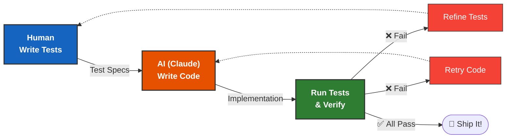

## 本章小结

Agentic Coding（代理式编程）正在改变软件工程的工作方式。
本章介绍了从 “Copilot”（副驾驶）到 “Agent”（自主代理）的转变：前者是 **辅助输入**，后者是 **结果交付**。

### 核心知识点回顾

#### Claude 的角色

*   **Polyglot Expert**: 熟悉从 Rust 到 Fortran 的多种编程语言。
*   **Context Master**: 1M Token 的上下文使其能读入整个项目的核心逻辑，这是它能做系统级重构的关键。

#### 工具链体系

*   **Claude Code CLI**: `claude` 命令让 AI 能够访问文件系统和 shell，从而形成 “Coding -> Testing -> Fixing” 的闭环。
*   **IDE Integration**: Cursor 和 VS Code Plugins 提升了 AI 的上下文感知（Context Awareness）能力。

#### 工作流变革

**图 7-1：Agentic Coding TDD 2.0 循环**

*   **TDD 2.0**: 人写测试，AI 写实现。用测试用例约束 AI 的发散，是目前最稳健的开发模式。
*   **Legacy Refactoring**: 无人敢动的遗留代码，可以交给 AI 清理、注释和升级。

#### 成功法则

*   **Context is King**: 提供给 AI 的上下文（Context）必须准确、相关，不要让它猜测。
*   **Trust but Verify**: AI 能力很强，但并不完美。Code Review 因此更加重要，审查对象除 Bug 外，还包括逻辑漏洞和安全隐患。

### 开发者自检清单

- [ ] **工具就绪**：我是否安装了 `claude-code` CLI 并配置了 `CLAUDE.md`？
- [ ] **环境集成**：我的 IDE (VS Code/Cursor) 是否能顺畅地调用 Claude？
- [ ] **协作模式**：我是否尝试过“我写 Test，它写 Code”的 TDD 模式？
- [ ] **安全意识**：在 CLI 中使用自动模式 (`--permission-mode auto`) 时，我是否清楚这一步操作的后果（尤其是 `rm`, `git push`）？

### 下一章

以上是单个 Agent 的用法。设想一家只有 AI 员工的公司：
一个 AI 做产品经理，一个做后端，一个做前端，一个做测试，它们需要互相沟通、互相 Review。
这就是 **Multi-Agent Systems（多智能体系统）**。

[**第八章**](../08_agent/README.md)介绍 **Agent 架构** 的设计。

➡️ [Agent 架构设计](../08_agent/README.md)

---

> 📝 **发现错误或有改进建议？** 欢迎提交 [Issue](https://github.com/yeasy/claude_guide/issues) 或 [PR](https://github.com/yeasy/claude_guide/pulls)。
