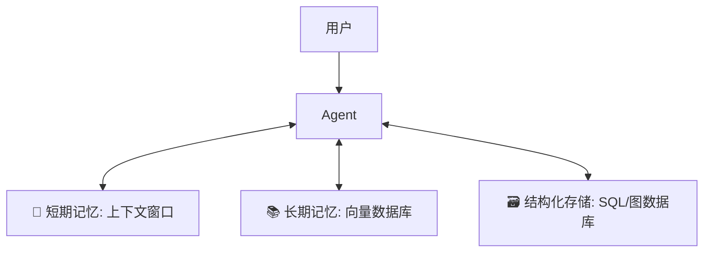

## 8.3 上下文管理与记忆

人类的大脑有短时记忆（工作记忆）和长时记忆（经验知识）。
高可用的 Agent 也需要这两层记忆结构，只依赖单一的上下文窗口往往难以维护且成本高。

### 8.3.1 记忆的分层架构


**图 8-1：Agent 记忆分层架构示意图**

如上图所示，完整的记忆系统由不同介质、不同访问速度的存储层组成，类似于计算机的寄存器（极快但极小）、内存（快且适中）和硬盘（慢但海量）。

在 Claude Agent 的设计中，记忆通常分为以下三个层级，分别对应不同的应用场景：

#### Working Memory

*   **介质**: 模型的 Context Window (Prompt)。
*   **内容**: 当前正在进行的对话、最近几步的思考过程 (CoT)、临时变量。
*   **特点**: 速度快，但容量有限，掉电（会话结束）即失。

#### Episodic Memory

*   **介质**: 向量数据库 (Vector DB)。
*   **内容**: 过去发生过的类似事件、历史对话记录。
*   **实现**: RAG (Retrieval-Augmented Generation)。当用户问起“上周我们讨论了什么方案”时，Top-k 检索相关的历史片段注入 Context。

#### Semantic Memory

*   **介质**: 外部知识文档、结构化数据库。
*   **内容**: 公司的 SOP、产品手册、Fast Facts。

### 8.3.2 上下文记忆 vs 权重记忆：Agent 排错的关键区分

上述三层架构解决的是“如何存取信息”，更根本的问题是信息存放在哪里。LLM 的知识载体分为**上下文记忆**（存在于 Prompt 中，即取即用但会话结束即消失）和**权重记忆**（通过预训练固化在参数中，模型发布后即冻结）。

这一区分直接影响 Agent 排错：Agent 回答错误时，需要判断问题出在哪一层。如果是上下文不足（该给的信息没给），可以通过改进 RAG 或扩大窗口解决；如果是权重本身的知识缺陷（模型“从来没学过”），则只能等待下一代模型或通过工具调用弥补。

> 关于上下文记忆与权重记忆的深层原理（Position Interpolation、持续学习、灾难性遗忘等）的详细分析，参见姊妹篇《大模型原理与架构》14.9.5 节。

### 8.3.3 突破上下文窗口限制的技术

> 上下文窗口的需求没有上限。当 Agent 从“聊天助手”发展为需要处理整个代码库、进行多轮工具调用的“自主执行者”时，上下文需求很容易超过百万 token。分层 Memory 和压缩策略都是过渡方案；在智能压缩成熟之前，直接扩大窗口仍是最有效的路径。

#### Prompt Caching（提示缓存）

Anthropic 于 2024 年 8 月在 API 中推出的 **Prompt Caching** 功能可以大幅降低 Agent 成本。
*   **原理**: 由于 Agent 的 System Prompt 和 RAG 文档在多轮对话中是不变的，Anthropic 允许将这些静态部分（Prefix）缓存起来。
*   **收益**: Input Token 成本最高可降低 **90%**，长提示词的延迟最高可降低 **85%**（官方口径）。
*   **用法**: 在发送请求时，在可复用内容块上添加 `cache_control` 标记；默认 5 分钟缓存不需要额外 beta header。1 小时缓存现已 GA，在 `cache_control` 中写 `"ttl": "1h"` 即可，同样无需 beta header。

#### Memory Tool

除隐式的 RAG 外，还可以给 Agent 一个显式的“记事本工具”。

**Tool Definition**:
```json
{
  "name": "manage_memory",
  "description": "Store important facts about the user.",
  "parameters": {
    "action": "save | read | delete",
    "key": "user_preference",
    "value": "prefers dark mode"
  }
}
```

**Workflow**:
1.  User: “以后生成的代码都用 Python。”
2.  Agent Call: `manage_memory(action="save", key="coding_lang", value="Python")`.
3.  (Three days later) User: “写个脚本。”
4.  Agent Call: `manage_memory(action="read", key="coding_lang")` -> "Python".

#### Progressive Disclosure（渐进式上下文加载）

Claude Code 团队在实践中发现，与其一次性把所有文档放进系统提示词，不如让 Agent **主动按需获取上下文**。这一策略体现在两个设计选择上：

**Grep 优于 RAG（在代码场景中）**：团队最初使用向量数据库（RAG）为 Agent 提供代码上下文，但后来发现直接给 Agent 一个 `Grep` 工具效果更好。原因是 RAG 返回的是预先切分的语义片段，而开发者需要的是精确的代码行定位和文件结构探索。`Grep` 工具让 Agent 能够像人类开发者一样，通过关键词搜索逐步深入代码库，自主建立对项目结构的理解。

**Agent Guide 模式**：团队没有在系统提示词中堆砌大量 Claude Code 的使用文档，而是提供了一个“Agent Guide”子代理（或链接）。只有当 Agent 遇到不确定的情况时，才调用这个子代理查询文档，主上下文因此保持精简。

**核心原则**：让 Agent 主动构建自己的上下文，而非被动接收预加载的海量信息。这样既节省 Token，又能让 Agent 获取更精准、更相关的信息。

#### Context Compression

当对话轮数（Turns）超过 50 轮时，直接截断会导致丢失早期目标。
**Summarization Strategy**:
*   每隔 10 轮对话，触发一个 Summary Agent。
*   将前 10 轮对话压缩成一段 200 字的摘要。
*   将这段摘要作为新的 System Prompt 的一部分，替换掉原始的历史记录。

### 8.3.4 Claude Code 记忆机制的分层分析示例

下面的 7 层结构是基于公开能力和工程观察整理的分析模型，用于理解长期任务中的成本、上下文与恢复设计；它不是 Anthropic 官方公布的内部架构说明：

**第 1 层 - 工具结果存储**：超过阈值的工具输出被持久化到磁盘（`tool-results/` 目录），仅保留约 2KB 的预览文本留在上下文中。状态“冻结”以最大化 Prompt Cache 命中率。

**第 2 层 - 微型压缩**：在每个 API 调用前运行三个机制：(1)时间机制：按本地状态保留策略清除旧工具结果，不要误把它等同于服务端 Prompt Cache TTL（默认 5 分钟；1 小时需显式 `ttl`）；(2)缓存微压缩——通过 cache_edits 进行服务端删除，无需破坏本地前缀；(3)API 级上下文管理。

**第 3 层 - 会话记忆**：设计最巧妙的一层。在 `~/.claude/projects/<slug>/.claude/session-memory/<sessionId>.md` 维护结构化笔记，模板包括：目标、已完成工作、当前状态、关键学习、待处理问题。压缩触发时注入此预构建摘要，无需额外 API 调用。

**第 4 层 - 完整压缩**：当令牌超过阈值（窗口 - 13K）时的紧急机制。通过分支 Agent 生成 9 段摘要，使用草稿思维（被剥离），有重试机制（3 次尝试，丢弃最旧消息组）。

**第 5 层 - 自动记忆提取**：任务结束时自动提取持久化知识到 `~/.claude/projects/.../memory/` 目录。四种记忆类型：项目模式、用户偏好、工具配置、领域知识。

**第 6 层 -「梦想」机制（auto-dream）**：足够会话积累后触发的跨会话记忆整合，对应 Claude Code 一个**尚未正式发布**的 `autoDreamEnabled` 设置（社区从 `cli.js` 二进制中发现，官方文档尚未收录；开启后可在 `/memory` 面板看到 “Auto-dream” 状态）。其四个阶段（定位 orient → 收集 gather → 合并 consolidate → 整理索引 prune & index）与社区公开的 dream agent 提示词一致。据社区对 `cli.js` 的分析，整合通过锁文件（`.consolidate-lock`，含 PID + 时间戳）互斥，整合 Agent 工具受限（Bash 只读，Edit/Write 仅限记忆目录）。

**第 7 层 - 跨 Agent 通信**：分支 Agent 模式，状态隔离但共享 Prompt Cache 前缀。Agent 摘要：Haiku 模型每 30 秒生成 3-5 字进度快照。

### 8.3.5 会话分支与工作状态恢复

在 Claude Code 的实践中，“记忆”指的是完整的**工作状态（Work State）**，而不只是对话历史。

#### 用户可用的会话操作

Claude Code 提供三种会话操作：

| 操作 | 用法 | 说明 |
| :--- | :--- | :--- |
| **Resume（恢复）** | `claude --resume` | 从中断处继续，恢复完整工作场景（包括进行中的计划和文件状态） |
| **Fork（分叉）** | `claude --resume <id> --fork-session` | 从某个时间点创建分支，后续独立演化 |
| **Subagent（子代理）** | Agent 工具自动派生 | 拥有独立上下文窗口的从属代理 |

关键区别在于：Resume 恢复的是**操作语境（Operational Context）**，而非仅仅是消息序列。Claude Code 保存的除了“说了什么”，还有“在做什么”，因此能在会话中断后“记住”正在进行的工作。

#### 对 Agent 设计的启示

1. **保存工作状态而非对话状态**：如果 Agent 需要支持中断和恢复，应该序列化的是“当前任务进度 + 待执行计划 + 中间产物”，而不仅仅是聊天记录
2. **惰性物化**：只在实际产生数据时才创建持久化文件，避免空会话占用存储
3. **事件日志优于消息列表**：将会话记录设计为带有元数据的事件流，便于后续的分析、回放和分支

### 8.3.6 记忆的生命周期管理

与人类会遗忘类似，Agent 的记忆也需要 GC (Garbage Collection)。

*   **TTL (Time-To-Live)**: 对于短期的任务状态，设置 24 小时过期。
*   **Relevance Scoring**: 检索记忆时，结合“语义相似度 + 时间衰减因子”。越近的记忆权重越高。
*   **Privacy Purge**: 提供“忘记我”功能，允许用户删除特定 Key 的记忆（符合 GDPR）。

---

有了记忆，Agent 就能处理长周期的任务。如果任务本身极其困难（比如证明黎曼猜想，或者规划登月工程），除记忆外还需要更长时间的 **深度思考**。

➡️ [Extended Thinking 扩展思考模式](8.4_extended_thinking.md)
