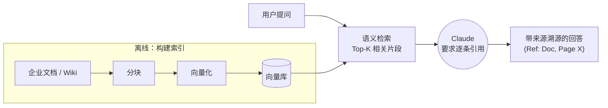

## 9.2 文档处理与知识库

IDP (Intelligent Document Processing) 是企业自动化中难度较高的领域。
传统 OCR 只能把图片转成文字，结果仍是非结构化的。Claude 的视觉能力和长文本理解能力，使其能够将非结构化文档转化为 **结构化数据 (JSON)**。

### 9.2.1 场景案例：非标财务文档抽取

一家投资机构每天收到上百份 PDF 格式的商业计划书 (BP) 和财务报表，格式各异。

#### 传统方案 vs Claude 方案

| 维度 | 传统 OCR + 正则表达式 | Claude Vision + JSON Mode |
| :--- | :--- | :--- |
| **格式适应性** | 极差，换个模板就失效 | 极强，基于语义理解 |
| **表格提取** | 经常错位 | 能完美理解跨页表格 |
| **手写体识别** | 困难 | 极高准确率 |
| **推理能力** | 无（只能提取表面文字） | 有（能计算“同比增长率”） |

### 9.2.2 实战：复杂财务报表提取

假设有一张扫描件（图片），其中包含一个复杂的“资产负债表”，还有跨页和合并单元格。

#### Input Prompt

> “这张图片是公司的资产负债表。请提取其中的关键财务数据，并验证数据是否平衡（资产 = 负债 + 所有者权益）。如果发现不平衡，请在 `validation_error` 字段中标注。请严格按照以下 JSON Schema 输出。”

#### Output JSON

```json
{
  "company_name": "Future Tech Inc.",
  "report_date": "2025-12-31",
  "currency": "USD",
  "assets": {
    "current_assets": {
      "cash": 5000000,
      "accounts_receivable": 2000000,
      "inventory": 1500000
    },
    "non_current_assets": {
      "property_plant_equipment": 10000000,
      "intangible_assets": 500000
    },
    "total_assets": 19000000
  },
  "liabilities": {
    "current_liabilities": 4000000,
    "long_term_liabilities": 5000000,
    "total_liabilities": 9000000
  },
  "equity": {
    "share_capital": 8000000,
    "retained_earnings": 2000000,
    "total_equity": 10000000
  },
  "validation": {
    "is_balanced": true,
    "calculation": "19000000 = 9000000 + 10000000"
  }
}
```

即使原图中没有显式写出 `total_assets` 的数字，Claude 也能通过计算推导出来；如果原图数字有误（如扫描模糊所致），它能根据会计恒等式发现并标记。

### 9.2.3 场景案例：企业知识库的语义增强

很多公司积累了大量 Wiki，但传统关键词搜索经常找不到所需内容。

RAG（检索增强生成）把企业文档变成可检索的知识库，让 Claude 基于检索到的片段作答并标注来源：



#### 语义搜索与引用溯源

Anthropic API 引入了更精准的 **Citations** 能力（自 2025 年初上线，现行模型均已支持）。在 RAG 系统中，可以要求 Claude 在回答的同时注明依据来自哪一行。

**User Question**: “公司差旅标准里，打车费有限额吗？”

**Claude Response**:
> 根据《员工差旅管理制度 V2.0》第 4 章第 2 条：
> 1. 一般员工在一线城市（北上广深）打车限额为 **150 元/天**。`(Ref: doc_travel_policy.pdf, page 12, para 3)`
> 2. 如果加班至 22:00 以后，通过企业用车平台打车 **不设上限**。`(Ref: doc_travel_policy.pdf, page 12, para 5)`

**技术实现**:
在 System Prompt 中强制要求：`Every claim must be followed by a citation like [Source: Doc Name, Page X].`

### 9.2.4 最佳实践：Human-in-the-Loop Review

处理财务数据（Invoice Processing）时，准确率要求是 100%，因此需要人工审核兜底。

**基于置信度的混合工作流**:

1.  **AI 处理**: Claude 提取发票信息，并输出一个 `confidence_score` (0.0 - 1.0)。
2.  **自动分流**:
    *   `score > 0.98`: **直通** -> 自动调用 API 录入 SAP 系统。
    *   `score <= 0.98`: **人工审核** -> 推送到审核人员界面。
3.  **UI 辅助**: 在人工审核界面，使用 bounding box 将 Claude 提取的区域在原图上高亮显示，审核员只需目视核对，确认数字无误后点击“通过”。这比纯人工录入快 10 倍。（注：Claude 视觉 API 本身不返回像素级坐标；bounding box 通常由 OCR/版面分析层提供，再与 Claude 的抽取结果对齐。）

---

文档处理把静态文档变为可用的数据，数据分析则从数据中提取价值。
Claude 能读懂 Excel，也能自己写 SQL 查询数据库，这就是 **Text-to-Insight**。

➡️ [数据分析助手](9.3_data_analysis.md)
