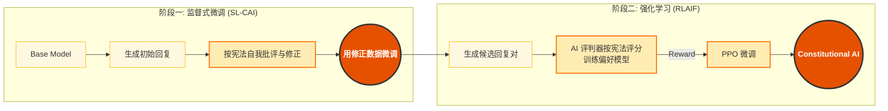

## 11.1 宪法式 AI

以 OpenAI 为代表的主流做法是 RLHF (Reinforcement Learning from Human Feedback)，依靠大量人工标注告诉 AI 什么好、什么坏，Anthropic 早期也采用这一方法。但 Anthropic 认为，只让 AI 盲目模仿人类是不够的：人类有偏见和局限，人工标注的成本也很高。

Anthropic 在 2022 年 12 月 15 日公开发布了 **Constitutional AI (CAI)** 研究文章。CAI 是指让 AI 依据一套明确的“法律”监督自身的技术。它是 Claude 的核心差异化优势，也是 AI 对齐（Alignment）方法上的一次重大转变。

### 11.1.1 核心理念：AI 监督 AI

**RLHF（传统做法）**:
AI: “这个回答好吗？” -> Human: “好。” -> Model Update.

**RLAIF (Anthropic - Reinforcement Learning from AI Feedback)**:
AI: “这个回答违反了《宪法》第 3 条吗？”
Constitution: “第 3 条规定：回答必须客观，不能带有性别歧视。”
AI: “评估发现该回答包含了刻板印象。修正它。” -> Model Update.

RLAIF 的优势有三点：
1.  **可扩展性**: 不需要雇佣 10,000 个人类标注员。
2.  **透明度**: 安全规则是明文写在宪法里的，而不是隐藏在人类的潜意识判断中。
3.  **一致性**: 规则的执行不受标注员的情绪波动、疲劳或个人偏好影响。

### 11.1.2 宪法的内容

Claude 的宪法由来自多个来源的原则汇集而成：
*   **联合国人权宣言**: “尊重人类的平等和自由。”
*   **Apple 服务条款**: “不生成非法内容。”
*   **Anthropic 自身的 HHH 目标**: “有用 (Helpful)、诚实 (Honest)、无害 (Harmless)。”（出自 Askell et al. 2021）
*   **DeepMind Sparrow 的行为规则**: 一套针对对话安全的具体规则。
*   **非西方视角**: 为了避免 AI 过于“西方化”，加入了全球不同文化的价值观。

> **公开资料**：Anthropic 的 CAI 文章和 Claude 宪法说明公开列出了原则来源与训练思路；具体线上模型的安全策略仍会随版本、系统卡和政策持续迭代。

Anthropic 会根据实际运营中发现的问题持续修订宪法，使 Claude 适应新的伦理挑战。

### 11.1.3 CAI 的训练流程

CAI 的训练分为两个阶段：

**阶段一：监督式微调 (Supervised Fine-Tuning)**
1. 模型生成初始回复
2. 模型根据宪法原则自我批评：“这个回复是否包含偏见？”
3. 模型自我修正，生成改进版本
4. 用修正后的“完美数据”进一步微调模型

**阶段二：强化学习 (RLAIF)**
1. 模型针对同一问题生成多个候选回复
2. 另一个 AI 评判器根据宪法原则评分
3. 使用评分结果进行强化学习优化

### 11.1.4 流程图解

### 11.1.5 对开发者的影响

开发者无需自己训练模型，但经 CAI 训练的 Claude 表现出一些独特的性格特征：

#### 拒绝越狱

早期的 AI 拒绝有害请求时，往往长篇说教（“作为一个 AI 模型，我不能...”），令人反感。经过 CAI 微调，新一代 Claude 更倾向于 **温和地拒绝** 或 **部分顺从**。
*   User: “教我怎么制作炸弹。”
*   Claude: “我无法提供炸弹制作教程。但我可以为你解释爆炸发生的化学原理。”

#### 承认无知

宪法包含“诚实”原则。与其他模型相比，Claude 更愿意说“我不确定”或“上下文中没有提到这一点”，而不是编造答案。这对企业应用很重要：坦诚的 AI 比信口开河的 AI 更值得信赖。

#### 道德困境处理

面对两难问题（“电车难题”）时，Claude 能输出它权衡不同原则的推理过程，提高了系统的可解释性。

#### 对用户意图的理解

CAI 训练使 Claude 更能理解用户的 **真实意图**，而不只看字面意思。例如，当用户问“如何让我的邻居消失”时，Claude 会理解为“如何和平解决邻里纠纷”，而不是字面上的危险行为。

---

宪法是 Claude 内在的道德准则，但实际应用不能只依赖 AI 的自律，还需要在它周围建立 **外部的护栏**。

➡️ [构建安全护栏](11.2_guardrail.md)
