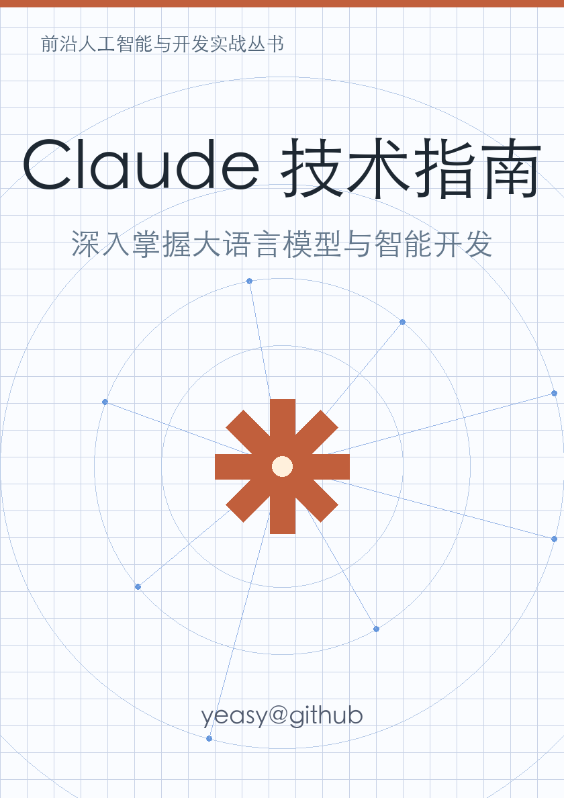

# Claude 技术指南

从日常对话和提示词入手，掌握 Claude API、Claude Code 与智能体应用开发。

**[在 GitBook 阅读第一章 · 认识 Claude](https://yeasy.gitbook.io/claude_guide/di-yi-bu-fen-ji-chu-pian/01_intro)**

[全书目录（GitHub）](https://github.com/yeasy/claude_guide/blob/main/SUMMARY.md) · [正式 PDF（发布页）](https://github.com/yeasy/claude_guide/releases/latest)



## 关于本书

**Claude** 是目前业界最先进的生产环境大语言模型之一。本书是面向开发者、产品负责人、自动化工程师和企业架构师的 Claude 生态落地手册，重点回答：什么时候选择 Claude，如何选择 Claude 的产品面，以及如何把 API、Claude Code、Agent SDK、MCP、Skills、Computer Use 和安全治理组合成可上线方案。

> *注：本书不会替代通用提示词工程、上下文工程、智能体理论或 Harness 工程专著；这些主题会在需要时交叉引用。本书聚焦 Claude 特有能力、接口边界、产品组合、迁移策略和上线判断。模型 ID、价格、上下文窗口和功能可用性变化很快，生产选型请以官方模型页、价格页和相关产品文档为准。*

本书围绕 Claude Fable、Opus、Sonnet、Haiku 各系列的核心能力展开；弃用状态同样以官方模型页为准。

## 从哪里开始

- **日常使用** · 先在 [claude.ai](https://claude.ai) 试一次对话，再用[提示词基础](https://yeasy.gitbook.io/claude_guide/di-yi-bu-fen-ji-chu-pian/02_prompt/2.1_basics)和 [XML 标签示例](https://yeasy.gitbook.io/claude_guide/di-yi-bu-fen-ji-chu-pian/02_prompt/2.2_xml)改写同一个任务，对比两次回答。
- **接入 Claude API** · 先用 [API 参考手册](https://yeasy.gitbook.io/claude_guide/fu-lu/12_appendix/12.1_api_ref)发出第一条消息，再读[工具调用与结果反馈](https://yeasy.gitbook.io/claude_guide/di-er-bu-fen-gong-ju-pian/03_tools/3.3_results)，了解应用如何执行工具并把结果交回模型。
- **用 Claude Code 开发** · 从 [Claude Code CLI 入门](https://yeasy.gitbook.io/claude_guide/di-san-bu-fen-jin-jie-pian/07_coding/7.2_cli)开始，在熟悉的项目中练习读代码、审阅改动和设置权限。需要程序化集成时，继续读 [Agent SDK 集成](https://yeasy.gitbook.io/claude_guide/di-san-bu-fen-jin-jie-pian/07_coding/7.3_sdk)。

<details>

<summary>按角色选读与前置知识</summary>

第一次使用 Claude 时，可用五分钟体验对话（2 分钟）、提示词改写（2 分钟）和[工具调用原理](https://yeasy.gitbook.io/claude_guide/di-er-bu-fen-gong-ju-pian/03_tools/3.1_overview)（1 分钟）。普通用户可继续读第 1–3 章，了解模型选择、日常对话与工具使用。

- **AI 应用开发者与自动化工程师** · 先读第 1–2 章，再结合附录 A 的 API 手册练习第 3–8 章，最后用第 9–11 章和附录 G 核对案例、成本及安全要求。
- **产品负责人、业务人员与企业架构师** · 从第 1 章了解能力边界，选读第 8–11 章规划应用，再查第 13 章及附录 A、F、G，核对方案所用的接口和能力。
- **提示词工程师** · 读第 1–2 章与第 3.1–3.3 节，再结合第 4–6 章的示例练习提示词结构、工具调用与多模态任务设计。
- **AI 研究爱好者** · 从第 1 章了解模型演进，再读[模型内部可解释性](https://yeasy.gitbook.io/claude_guide/di-wu-bu-fen-jin-jie-neng-li/13_advanced/13.4_model_interpretability)。

日常使用需要基础计算机操作经验和 Claude 访问权限，了解大语言模型的基本概念会有帮助。做 API 练习前应了解 Python 或 JavaScript、HTTP 和 JSON。练习 MCP 与 Computer Use 需要熟悉命令行、包管理和 Docker 等容器工具。练习 Claude Code 需要熟悉 Git、终端和项目权限边界。

</details>

<details>

<summary>可执行示例与离线测试</summary>

仓库提供三条可离线测试、真实运行时再读取凭据的最小路径。

- [Messages API 最小调用](https://github.com/yeasy/claude_guide/blob/main/examples/messages_api.py)
- [完整客户端工具循环](https://github.com/yeasy/claude_guide/blob/main/examples/tool_use_loop.py)
- [Agent SDK 成功/失败事件处理](https://github.com/yeasy/claude_guide/blob/main/examples/agent_sdk_minimal.py)

安装 [`examples/requirements.txt`](https://github.com/yeasy/claude_guide/blob/main/examples/requirements.txt) 锁定的依赖后，测试可在离线环境运行，无需 API key。

```bash
python3 -m venv .venv && . .venv/bin/activate
python3 -m pip install -r examples/requirements.txt
python3 -m unittest discover -s tests -p 'test_*.py' -v
```

真实运行 `messages_api.py` 前按 Anthropic SDK 文档配置 `ANTHROPIC_API_KEY`。Agent SDK 示例使用该 SDK 支持的 Claude Code 或 API 凭据机制。不要把凭据写入仓库。

</details>

## 全书结构

- **基础篇（第 1–2 章）** · [Claude 概览与模型选择](https://yeasy.gitbook.io/claude_guide/di-yi-bu-fen-ji-chu-pian/01_intro)、[提示工程](https://yeasy.gitbook.io/claude_guide/di-yi-bu-fen-ji-chu-pian/02_prompt)。
- **工具篇（第 3–5 章）** · [工具调用](https://yeasy.gitbook.io/claude_guide/di-er-bu-fen-gong-ju-pian/03_tools)、[MCP](https://yeasy.gitbook.io/claude_guide/di-er-bu-fen-gong-ju-pian/04_mcp) 和 [Computer Use](https://yeasy.gitbook.io/claude_guide/di-er-bu-fen-gong-ju-pian/05_computer_use)。
- **进阶篇（第 6–8 章）** · [Skills](https://yeasy.gitbook.io/claude_guide/di-san-bu-fen-jin-jie-pian/06_skills)、[Claude Code](https://yeasy.gitbook.io/claude_guide/di-san-bu-fen-jin-jie-pian/07_coding) 与 [Agent 架构设计](https://yeasy.gitbook.io/claude_guide/di-san-bu-fen-jin-jie-pian/08_agent)。
- **实战篇（第 9–11 章）** · [企业应用案例](https://yeasy.gitbook.io/claude_guide/di-si-bu-fen-shi-zhan-pian/09_practical)、[成本与性能](https://yeasy.gitbook.io/claude_guide/di-si-bu-fen-shi-zhan-pian/10_optimization)、[安全与伦理](https://yeasy.gitbook.io/claude_guide/di-si-bu-fen-shi-zhan-pian/11_safety)。
- **进阶能力（第 13 章）** · [Claude 前沿特性、上下文工程与模型可解释性](https://yeasy.gitbook.io/claude_guide/di-wu-bu-fen-jin-jie-neng-li/13_advanced)。
- **[附录](https://yeasy.gitbook.io/claude_guide/fu-lu/12_appendix)** · API、常见问题、术语、资源、定价与竞品对比，以及[快变事实核验表](https://yeasy.gitbook.io/claude_guide/fu-lu/12_appendix/12.7_volatile_facts)。

## 延伸阅读

- [大模型提示词工程指南](https://yeasy.gitbook.io/prompt_engineering_guide/) · 学习通用提示词原理与实践。
- [大模型上下文工程权威指南](https://yeasy.gitbook.io/context_engineering_guide/) · 从提示词设计扩展到生产环境中的上下文管理。
- [智能体 Harness 工程指南](https://yeasy.gitbook.io/harness_engineering_guide/) · 理解 Claude Code 等智能体的运行基础设施。

<details>

<summary>更多系列图书</summary>

- [零基础学 AI](https://yeasy.gitbook.io/ai_beginner_guide/) · 从基础概念入门。
- [智能体 AI 权威指南](https://yeasy.gitbook.io/agentic_ai_guide/) · 深入智能体架构、多智能体协作与 AgentOps。
- [大模型安全权威指南](https://yeasy.gitbook.io/ai_security_guide/) · 学习大模型安全攻防与治理。
- [OpenClaw 从入门到精通](https://yeasy.gitbook.io/openclaw_guide/) · 学习开源智能体框架的使用与原理。
- [大模型原理与架构](https://yeasy.gitbook.io/llm_internals/) · 理解大语言模型的底层原理与架构。

</details>

## 贡献与反馈

欢迎在 [GitHub Issues](https://github.com/yeasy/claude_guide/issues) 报告勘误或失效链接，也可以[提交 Pull Request](https://github.com/yeasy/claude_guide/pulls)修订内容或补充案例。

<details>

<summary>本地开发与预览</summary>

安装 [mdPress](https://github.com/yeasy/mdpress) 后，在仓库根目录启动本地预览，再打开 `http://localhost:9000`。

```bash
brew tap yeasy/tap && brew install mdpress
mdpress serve
```

[默认分支 PDF 预览版](https://github.com/yeasy/claude_guide/releases/download/preview-pdf/claude_guide.pdf)随主线更新，正式版本以发布页为准。

</details>

## 许可证

本书采用 [CC BY-NC-SA 4.0](https://creativecommons.org/licenses/by-nc-sa/4.0/) 授权。
